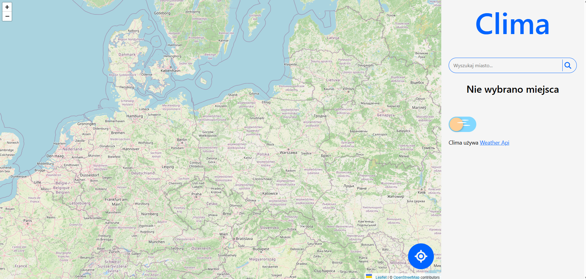

# Clima App

A simple weather application built to learn the basics of the React library and communication with external APIs.

## Project Status: Inactive
This project served an educational purpose and is now inactive. Due to the expiration of the API keys and API subscription plan changes, the application no longer fetches live data. The main goal of the project—practical mastery of React fundamentals—has been fully achieved.

## Technologies Used
* React (UI creation and component architecture)
* HTML & CSS
* External Weather API (OpenWeatherMap)
* External Map Tiles API (OpenStreetMap)

## Key Skills Acquired
* Fetching and asynchronously processing data from a REST API (Fetch API / Axios).
* Managing application state and component lifecycle using hooks (`useState`, `useEffect`).
* Dynamic data rendering and conditional display of UI elements.
* Basics of structuring modern frontend applications.